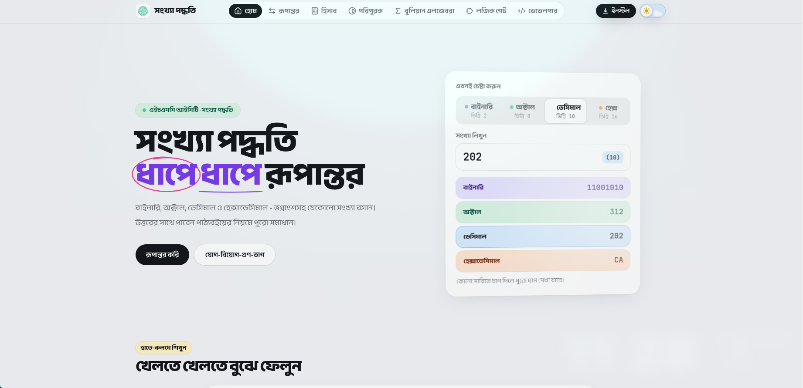

<div align="center">

# সংখ্যা পদ্ধতি · Number System

**HSC ICT-এর সংখ্যা পদ্ধতি, পরিপূরক, বুলিয়ান এলজেবরা ও লজিক গেট: ধাপে ধাপে বাংলা ব্যাখ্যাসহ ইন্টারেক্টিভ ওয়েব অ্যাপ**

[](https://ictlogic.vercel.app/)
[](https://github.com/Hafiz-Sakib/Number-System)


<br />

<a href="https://ictlogic.vercel.app/">
  
</a>

</div>

---

## 🔗 লিংক

| | |
|---|---|
| 🌐 **Live** | [ictlogic.vercel.app](https://ictlogic.vercel.app/) |
| 💻 **Source** | [github.com/Hafiz-Sakib/Number-System](https://github.com/Hafiz-Sakib/Number-System) |

## ✨ কী কী আছে

| পেজ | পাথ | বিষয় |
|---|---|---|
| 🏠 **হোম** | `/` | লাইভ রূপান্তর কার্ড, ১০টি ইন্টারেক্টিভ অ্যানিমেশন (বাইট সুইচ, গণনার দৌড়, ২ দিয়ে ভাগ, মন-পড়া কার্ড, মিনি লজিক গেট, হেক্স রঙ মিক্সার, ASCII/Unicode, IPv4, BCD ঘড়ি, 7-সেগমেন্ট) এবং বাস্তব জীবনের উদাহরণ (পেনড্রাইভের 64 GB → 59 GB, রঙ ও ছবির সাইজ) |
| 🔁 **রূপান্তর** | `/convert` | বাইনারি, অক্টাল, ডেসিমাল, হেক্সাডেসিমাল: ভগ্নাংশসহ, পাঠ্যবইয়ের নিয়মে পুরো সমাধান |
| ➕ **হিসাব** | `/calc` | যোগ, বিয়োগ, গুণ, ভাগ (যোগে সর্বোচ্চ 10টি সংখ্যা), কলাম-হিসাবসহ ধাপ |
| ⚖️ **পরিপূরক** | `/complement` | 1's ও 2's কমপ্লিমেন্ট (দশমিকসহ), negative সংখ্যা, পরিপূরক দিয়ে বিয়োগ |
| ∑ **বুলিয়ান এলজেবরা** | `/algebra` | উপপাদ্য, সত্যক সারণী (সর্বোচ্চ 4 চলক), ডি-মরগান, সরলীকরণ ও Quine–McCluskey-এর পুরো হিসাব |
| 🔌 **লজিক গেট** | `/gates` | AND/OR/NOT, NAND/NOR, XOR/XNOR, এনকোডার, ডিকোডার, হাফ/ফুল/৪-বিট অ্যাডার, রেজিস্টার, কাউন্টার (SVG সার্কিট) |
| 👨‍💻 **ডেভেলপার** | `/dev` | ডেভেলপারের পরিচিতি, দক্ষতা, প্রজেক্ট |

**আরও:** দিন/রাত থিম · ফোনে নিচের ট্যাব বার · PWA (ইনস্টল করে অফলাইনে চলে) · বাংলা অঙ্ক (১০১০) ও ছোট হাতের হেক্স (`ff`) ইনপুট।

## 🛠️ টেকনোলজি

- **React 18** + **Vite 6**
- **Tailwind CSS 3** (CSS variable-ভিত্তিক থিম)
- **Framer Motion**: অ্যানিমেশন
- **three.js**: 3D বিট-কিউব (lazy-load)
- **vite-plugin-pwa / Workbox**: PWA
- ফন্ট: Anek Bangla, JetBrains Mono

## 🚀 চালানো

```bash
git clone https://github.com/Hafiz-Sakib/Number-System.git
cd Number-System

npm install
npm run dev        # ডেভেলপমেন্ট সার্ভার
npm run build      # প্রোডাকশন বিল্ড (dist/)
npm run preview    # বিল্ড প্রিভিউ
npm test           # গণনা ইঞ্জিনের স্বয়ংক্রিয় পরীক্ষা
```

Vercel-এ ডিপ্লয় করলে `vercel.json` সব পাথ `/`-এ পাঠায় (SPA রাউটিং)।

## 📁 ফোল্ডার কাঠামো

```text
Number-System/
├── docs/
│   └── screenshot.png          # README-র স্ক্রিনশট
├── public/                     # স্ট্যাটিক ফাইল: আইকন, PWA আইকন, CV, ডেভ পেজের ছবি
│   └── dev/                    # প্রজেক্টের থাম্বনেইল
├── scripts/
│   ├── make-icons.py           # PWA আইকন তৈরি
│   ├── test-engine.mjs         # রূপান্তর ও গণিত ইঞ্জিনের পরীক্ষা
│   ├── test-complement.mjs     # পরিপূরকের পরীক্ষা
│   ├── test-logic.mjs          # লজিক ইঞ্জিনের পরীক্ষা
│   ├── test-simplify.mjs       # সরলীকরণের পরীক্ষা
│   └── test-qm.mjs             # Quine–McCluskey-এর পরীক্ষা
├── src/
│   ├── main.jsx                # এন্ট্রি পয়েন্ট
│   ├── App.jsx                 # লেআউট ও রাউট
│   ├── theme.js, index.css     # থিম ও গ্লোবাল স্টাইল
│   ├── lib/
│   │   ├── engine.js           # সব গণিত (BigInt, ভগ্নাংশসহ নিখুঁত) + ব্যাখ্যার ব্লক
│   │   ├── complement.js       # 1's / 2's কমপ্লিমেন্ট
│   │   ├── logic.js            # বুলিয়ান এলজেবরা, সরলীকরণ, qmTrace()
│   │   ├── router.js           # হালকা নিজস্ব রাউটার
│   │   ├── settings.js         # ব্যবহারকারীর সেটিংস (precision ইত্যাদি)
│   │   └── site.js, team.js    # সাইটের নাম ও ডেভেলপারের তথ্য
│   ├── components/
│   │   ├── Steps.jsx           # সমাধানের ধাপ আঁকে (টেবিল, কলাম-হিসাব)
│   │   ├── HomePlay.jsx        # হোমের ১০টি ইন্টারেক্টিভ সেকশন
│   │   ├── HomeExtra.jsx       # হোমের বাস্তব জীবনের উদাহরণ
│   │   ├── Circuit.jsx         # গেট-লেভেল SVG সার্কিট
│   │   ├── Bits3D.jsx, BitCubes.jsx   # three.js বিট-কিউব
│   │   ├── TopBar.jsx, TabBar.jsx, Footer.jsx, ThemeToggle.jsx
│   │   └── ui.jsx, controls.jsx, icons.jsx, ...
│   └── sections/               # প্রতিটি পেজ
│       ├── Home.jsx
│       ├── Convert.jsx
│       ├── Calc.jsx
│       ├── Complement.jsx
│       ├── BooleanAlgebra.jsx
│       ├── LogicGates.jsx
│       ├── Dev.jsx
│       └── logic/              # Algebra, Gates, Combinational, Sequential, Shell
├── index.html
├── vite.config.js
├── tailwind.config.js
├── postcss.config.js
├── vercel.json
└── package.json
```

## 📝 নোট

- ডেসিমাল → অন্য পদ্ধতিতে ভগ্নাংশ শেষ না হলে **দশমিকের পর সর্বোচ্চ n ঘর** পর্যন্ত নেওয়া হয় (ছাঁটাই, গোল নয়) এবং উত্তরে `≈` দেখায়।
- যোগ, বিয়োগ, গুণ ও 2/8/16 ↔ রূপান্তর সবসময় নিখুঁত।
- বাইনারি বিয়োগে 1-এর ও 2-এর পরিপূরক, দুটি পদ্ধতিই দেখানো হয়।

## 👤 ডেভেলপার

**Hafiz Sakib** · Chattogram, Bangladesh

[Portfolio](https://hsakib.vercel.app) · [GitHub](https://github.com/Hafiz-Sakib) · [LinkedIn](https://www.linkedin.com/in/hafiz-sakib-96b8b3229/) · [Instagram](https://www.instagram.com/___sakib.404/)

---

<div align="center">

পছন্দ হলে ⭐ দিতে ভুলবেন না!

</div>
